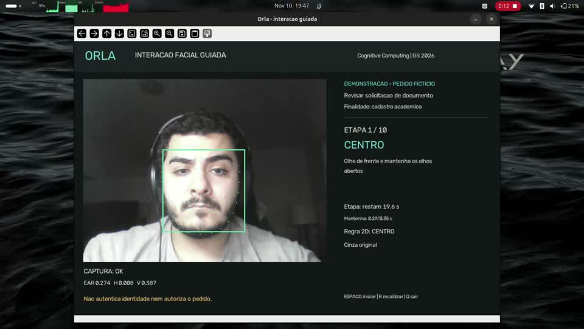

# Orla — interação facial guiada

**Tony Khaled Osman — RM 553050**

**Inacia dos Santos Silva — RM 553401**

Cognitive Computing, Computer Vision and IoT Systems — Professor Arnaldo Jr.

Protótipo local em Python que utiliza OpenCV e dlib para detectar uma face, estimar 68 pontos faciais e acompanhar quatro direções da cabeça e uma piscada completa. Integra o tema Orla por meio de uma solicitação fictícia de documento. Não reconhece identidade nem autoriza transações.

## Demonstração

Vídeo de um aluno demonstrando o funcionamento da aplicação. Clique na imagem para abrir o vídeo.

[](https://github.com/TonyOsman/orla-computer-vision/blob/main/documentacao/midia/demonstracao-orla.mp4)

[Assistir à demonstração](https://github.com/TonyOsman/orla-computer-vision/blob/main/documentacao/midia/demonstracao-orla.mp4)

## Instalação — Ubuntu/Linux

Ambiente verificado: Python 3.12, Linux x86-64, webcam e sessão gráfica local. Windows e macOS não foram testados. Execute os comandos no terminal, na raiz do projeto, onde está este README. Após clonar o repositório, essa pasta é `orla-computer-vision`; no ZIP, ela se chama `orla`.

1. Instale os pré-requisitos do sistema (Ubuntu com Python 3.12):

```bash
sudo apt update
sudo apt install python3.12-venv python3.12-dev build-essential cmake libgl1 libglib2.0-0 wget bzip2
```

2. Crie o ambiente e instale as bibliotecas. Execute a próxima linha somente se a anterior terminar sem erro:

```bash
python3.12 -m venv .venv
.venv/bin/python -m pip install -r requirements.txt
```

A compilação do dlib pode demorar. A pasta `.venv` é criada localmente e não faz parte do repositório.

3. Baixe o modelo oficial de 68 pontos (necessário na cópia clonada; o ZIP de entrega já inclui o modelo):

```bash
mkdir -p modelos
wget -O modelos/shape_predictor_68_face_landmarks.dat.bz2 https://dlib.net/files/shape_predictor_68_face_landmarks.dat.bz2
bzip2 -d modelos/shape_predictor_68_face_landmarks.dat.bz2
```

Execute uma única vez, se `modelos/shape_predictor_68_face_landmarks.dat` ainda não existir. Confira o arquivo:

```bash
sha256sum modelos/shape_predictor_68_face_landmarks.dat
```

Resultado esperado: `fbdc2cb80eb9aa7a758672cbfdda32ba6300efe9b6e6c7a299ff7e736b11b92f`. Fonte: [modelo oficial](https://dlib.net/files/shape_predictor_68_face_landmarks.dat.bz2). O [exemplo oficial do dlib](https://dlib.net/face_landmark_detection.py.html) informa restrições de uso comercial relacionadas ao dataset iBUG; o uso deste projeto é acadêmico.

## Instalação — macOS

Procedimento documentado, ainda não validado em um Mac. Use Python 3.12 nativo da arquitetura do computador; não copie a `.venv` do Linux. Execute os comandos na raiz do projeto.

1. Instale as ferramentas de compilação da Apple e aguarde a instalação terminar:

```bash
xcode-select --install
```

Se já estiverem instaladas, continue. Com [Homebrew](https://brew.sh/) instalado:

```bash
brew install python@3.12 cmake
python3.12 -m venv .venv
.venv/bin/python -m pip install -r requirements.txt
```

2. Se o arquivo `.dat` não veio no ZIP, baixe e descompacte o modelo:

```bash
mkdir -p modelos
curl -fL https://dlib.net/files/shape_predictor_68_face_landmarks.dat.bz2 -o modelos/shape_predictor_68_face_landmarks.dat.bz2
bzip2 -d modelos/shape_predictor_68_face_landmarks.dat.bz2
shasum -a 256 modelos/shape_predictor_68_face_landmarks.dat
```

O hash esperado é o informado na seção Ubuntu/Linux.

3. Execute:

```bash
.venv/bin/python codigo/orla_interacao.py --camera 0
```

Autorize o acesso à câmera para o aplicativo usado para executar o programa (Terminal ou VS Code), caso solicitado pelo macOS.

## Instalação — Windows

Procedimento documentado para Windows x64, ainda não validado nesse sistema. Instale [Python 3.12 x64](https://www.python.org/downloads/windows/), [CMake](https://cmake.org/download/) com acesso pelo PATH e [Visual Studio Build Tools](https://visualstudio.microsoft.com/downloads/) com a carga **Desenvolvimento para desktop com C++**, compilador MSVC e Windows SDK. O VS Code sozinho não fornece esse compilador, necessário caso o dlib seja compilado durante a instalação.

Abra um novo PowerShell na raiz do projeto após instalar os pré-requisitos:

```powershell
py -3.12 --version
cmake --version
py -3.12 -m venv .venv
.\.venv\Scripts\python.exe -m pip install -r requirements.txt
```

Se `py` não estiver disponível, use o caminho completo do `python.exe` da instalação Python 3.12 no comando de criação do ambiente. Não copie a `.venv` de outro sistema. Se a compilação não localizar o MSVC, execute a instalação pelo **Developer PowerShell for Visual Studio**, na mesma pasta do projeto.

Se o modelo `.dat` não veio no ZIP, execute:

```powershell
New-Item -ItemType Directory -Force modelos | Out-Null
Invoke-WebRequest -Uri 'https://dlib.net/files/shape_predictor_68_face_landmarks.dat.bz2' -OutFile 'modelos/shape_predictor_68_face_landmarks.dat.bz2'
.\.venv\Scripts\python.exe -c "import bz2; from pathlib import Path; p=Path('modelos/shape_predictor_68_face_landmarks.dat.bz2'); p.with_suffix('').write_bytes(bz2.decompress(p.read_bytes()))"
Get-FileHash modelos\shape_predictor_68_face_landmarks.dat -Algorithm SHA256
```

Compare com o hash da seção Ubuntu/Linux. Para abrir a aplicação:

```powershell
.\.venv\Scripts\python.exe codigo/orla_interacao.py --camera 0
```

Esses comandos não precisam de `Activate.ps1` nem de alteração da política de execução do PowerShell. O Windows deve permitir acesso à câmera para aplicativos de desktop.

## Verificar a instalação

Linux/macOS:

```bash
.venv/bin/python -c "import cv2, dlib, numpy, matplotlib; print('Bibliotecas disponíveis')"
```

Windows (PowerShell):

```powershell
.\.venv\Scripts\python.exe -c "import cv2, dlib, numpy, matplotlib; print('Bibliotecas disponíveis')"
```

Se uma instalação falhar, corrija o erro antes de executar a próxima etapa. As versões fixadas em `requirements.txt` foram verificadas no Linux; compatibilidade e câmera em macOS/Windows dependem de validação nesses sistemas. Não substitua por `opencv-python-headless`, pois a aplicação usa janela gráfica.

Referências de instalação: [venv/Python](https://docs.python.org/3/library/venv.html), [compilação do dlib](https://dlib.net/compile.html), [Python 3.12/Homebrew](https://formulae.brew.sh/formula/python@3.12), [ferramentas Apple](https://developer.apple.com/documentation/xcode/installing-the-command-line-tools) e [C++/Microsoft](https://learn.microsoft.com/en-us/cpp/build/vscpp-step-0-installation).

## Executar

No terminal Linux/macOS, na raiz do projeto (no Windows, use o comando da seção anterior):

```bash
.venv/bin/python codigo/orla_interacao.py --camera 0
```

Não é necessário ativar o ambiente para usar esse comando. No VS Code, abra a raiz do projeto e use **Terminal → Novo Terminal**. O argumento `--camera 0` seleciona a webcam; sem ele o script apenas exibe a ajuda. A câmera não é aberta durante instalação ou testes de lógica.

- **ESPAÇO:** iniciar; olhar de frente com olhos abertos até concluir a calibração.
- **R:** reiniciar e recalibrar.
- **Q:** encerrar e liberar a câmera.

Faça movimentos leves, com iluminação frontal e uma única pessoa no quadro. Feche outros aplicativos que utilizem a câmera. Se necessário, troque `0` pelo índice da câmera desejada. O programa salva medidas e eventos, mas não grava imagens. Exige sessão gráfica; não use OpenCV headless.

## Organização

| Pasta/arquivo | Conteúdo |
|---|---|
| `codigo/` | Aplicação, métodos, configuração, testes e scripts de avaliação |
| `notebooks/` | Notebook executado de análise dos resultados |
| `documentacao/` | Relatório PDF, rastreabilidade das técnicas e protocolo de avaliação |
| `dados/` | Imagem pública de ensaio, sua origem e tabela de rótulos |
| `modelos/` | Diretório criado localmente para o modelo baixado |
| `resultados/` | Gráficos, medidas, testes e resumo do piloto |
| `requirements.txt` | Dependências da aplicação |
| `requirements-notebook.txt` | Dependências adicionais para o notebook |

## Reproduzir a avaliação

Execute na raiz do projeto. No Windows, substitua `.venv/bin/python` por `.\venv\Scripts\python.exe` nos comandos desta seção.

```bash
.venv/bin/python codigo/testar_logica.py
.venv/bin/python codigo/avaliar_imagens.py
.venv/bin/python codigo/avaliar_sessoes.py
```

O primeiro comando verifica 26 cenários de lógica. O segundo reproduz o ensaio de imagem e atualiza seus gráficos/tempos. O terceiro depende de rótulos independentes em `dados/tentativas.csv`; a tabela entregue está vazia e não produz uma taxa de acerto humano.

Para executar o notebook:

```bash
.venv/bin/python -m pip install -r requirements-notebook.txt
.venv/bin/python -m jupyterlab notebooks/analise_resultados.ipynb
```

## Resultados e limites

Os 26 testes de lógica passaram. O ensaio estático compreende cinco cenários derivados de um retrato público, dois modos de pré-processamento e três repetições: 30 execuções, não 30 pessoas. A equalização produziu falsos positivos adicionais nesse ensaio.

No piloto funcional de 10/11/2026 com um participante, três das cinco tentativas calibradas concluíram a sequência; duas foram reiniciadas. As conclusões levaram 13,351 s, 22,494 s e 17,997 s após a calibração. O participante confirmou movimentos leves e avanços correspondentes. São eventos do programa e autorrelato, sem rotulagem independente por ação: não representam acurácia populacional ou proteção antifraude.

O ajuste inicial calcula referências numéricas, sem foto cadastrada. O EAR frontal é exigido no centro e na preparação da piscada; os movimentos direcionais usam face válida, classe e sustentação. Inclinação excessiva, iluminação e perda de landmarks ainda podem interromper a sequência.

Referências às aulas, justificativas e limitações constam em `documentacao/rastreabilidade.md` e `documentacao/relatorio.pdf`.
